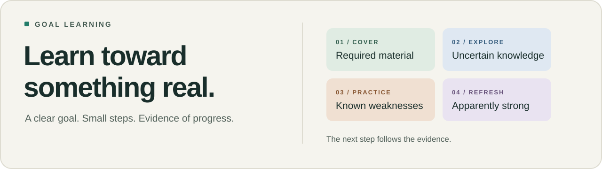
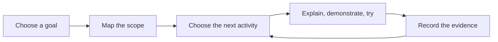

  <a href="docs/QUICKSTART.md">Start learning</a> ·
  <a href="AGENTS.md">For agents</a> ·
  <a href="docs/METHODS.md">Methods & evidence</a> ·
  <a href="docs/PROVENANCE.md">Origins</a>

# Goal Learning

**A practical way to learn with an AI tutor, toward something you can do on your own.**

Choose an outcome: pass an exam, build a parser, explain a paper, or learn a technical skill. Map what it requires. Work through it in small steps. Keep a record of what you can actually do, so the next session starts from evidence.

## A good conversation should lead somewhere

An explanation can feel clear while you are reading it. A familiar practice question can feel easy. Neither tells you whether you can solve a different problem tomorrow.

Goal Learning keeps three things visible:

| The goal | The coverage | The evidence |
| --- | --- | --- |
| What you want to do independently | What needs learning, and what has been taught | What you did, how much help you needed, and what still needs checking |

That separation matters. A topic can be covered but still uncertain. A correct answer after hints can be useful progress without being independent mastery.

## Pick the next step for a reason

The tutor balances four kinds of activity. There is no fixed exploration quota.

| Activity | When it helps | What happens |
| --- | --- | --- |
| **Cover** | Required material is still untouched | Explain the idea and work a complete example |
| **Explore** | Understanding is uncertain | Try a small, fair question to find out where you stand |
| **Practice** | A response reveals a weakness | Repair the gap and try a variation with less help |
| **Refresh** | Something seems strong but has gone unchecked | Sample it again, without assuming it has been forgotten |

A time limit changes priorities openly. Sample questions help test the map; they do not decide what belongs in it.

## Small sessions. A longer thread.

For a beginner, a session starts with an explanation and a worked example, then one manageable check. The tutor records the actual response and any help, adjusts the next activity, and saves a clear place to resume.

The record belongs to the learning goal. Another agent can pick it up without depending on the previous agent's hidden memory.

## Use it with the agent you have

Give your agent access to this repository and say:

> Follow AGENTS.md. Help me learn **[goal]**, starting from **[experience]**, with **[constraints]**. Map the scope before teaching, work one small part at a time, and keep coverage separate from demonstrated ability.

The protocol is Markdown and JSON. Optional Python tools check the ledger, suggest a next activity, and export a self-contained skill. No API keys or third-party Python packages are required. Agents without command execution can follow the same policy manually.

**[Start a goal →](docs/QUICKSTART.md)** &nbsp; **[Use another agent →](docs/AGENT-PORTABILITY.md)**

## What this does and does not establish

The methods draw on retrieval practice, worked examples, feedback and related learning research. The combined workflow and its allocation heuristic have not been validated as a learning intervention. The checker cannot discover every omitted topic or decide whether a tutor graded well.

A passing audit means the declared coverage checks passed. It does not predict a grade or prove mastery. Personal materials, responses and transcripts stay outside the public repository.

---

**Understand the approach** · [Workflow](docs/WORKFLOW.md) · [Topic allocation](docs/TOPIC-ALLOCATION.md) · [Research and limits](docs/METHODS.md)

**Inspect its origins** · [Upstream projects](docs/PROVENANCE.md) · [What went wrong in the first exam prep](docs/RECSYS-RETROSPECTIVE.md) · [What to improve next](docs/IMPROVEMENTS.md)

**Work on the system** · [Agent file index](agent-index.json) · [Commands and data](docs/AGENT-REFERENCE.md) · [Maintaining the repo](docs/MAINTAINING.md) · [Contributing](CONTRIBUTING.md)
